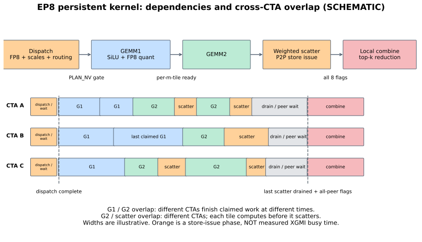
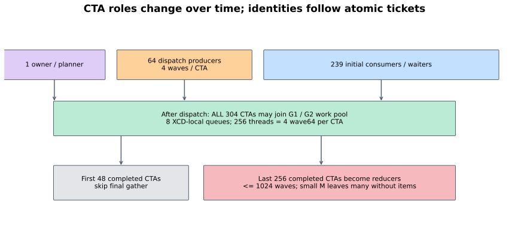
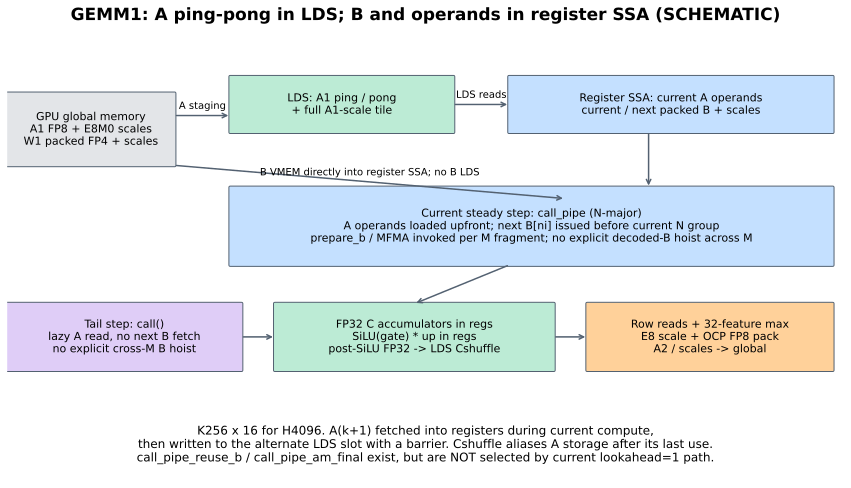
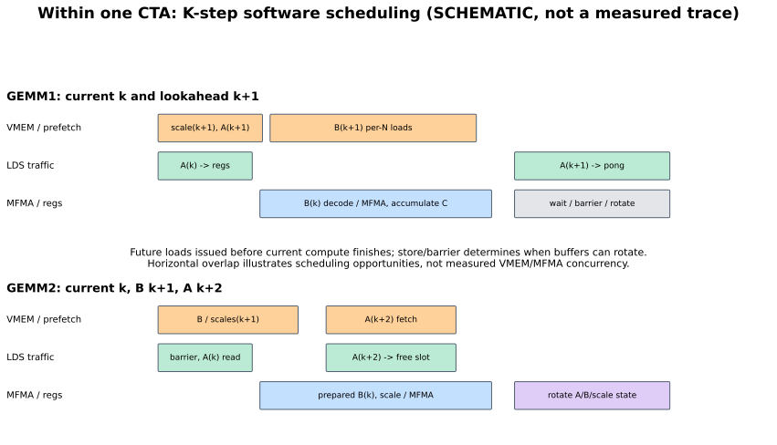
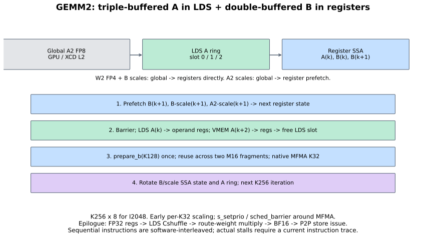
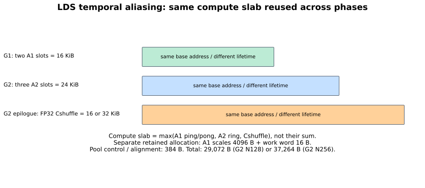
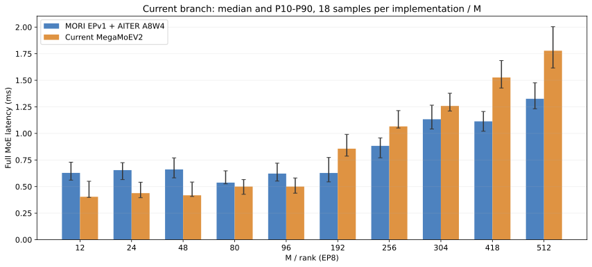
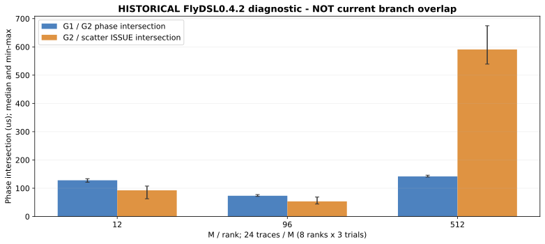

# MiMo decode MegaMoEV2：EP8 kernel 流水与 GEMM 优化设计

本文记录 FionaZZ92/aiter 的 `mimo_mega_decode` 分支中实际启用的 gfx942 A8W4 decode 实现。源码快照为 **`28e6b92136f72b7b3617ea720d1a0f27027e1cea`**；AITER 基线 `108940c2`，SGLang 基线 `2f6aebf2`，集成后的 SGLang 为 `040fefd9`。本次整理仅添加文档、配图及数据摘要。

当前实现将 dispatch、GEMM1、SiLU/量化、GEMM2、scatter 和最终 combine 放入同一个 persistent kernel。遮盖主要发生在 **不同 CTA 的 GEMM1 尾部与 GEMM2，以及 GEMM2 与 weighted scatter 发射阶段**。同一 GPU 的 dispatch 与 GEMM1、GEMM2 与最终 gather 存在完成依赖，不能全部隐藏。当前版本在 M=12–96 的测试中更快，M=192–512 有回退；完整数据见第 8 节。

## 1. 范围与证据

| 项目 | 本文使用的范围 |
|---|---|
| 模型 MoE 尺寸 | MiMov2.6-flash-mopd：H=4096，I=2048，E=256，top-k=8 |
| 并行 | 单机 EP8，8 张 gfx942，每 GPU 304 CU；每 rank 32 个 expert |
| 输入 M | 每 rank 原始 decode token 数：12、24、48、80、96、192、256、304、418、512 |
| 计算格式 | 激活 MXFP8，权重 MXFP4，32 元素一个 E8M0 scale，FP32 累加 |
| 选用配置 | `register_pressure` / `native_ab_early`；BM32，BK256，4 wave64/CTA |
| 对比基线 | MORI EPv1 dispatch + AITER A8W4 + MORI combine，完整 MoE 算子 |

M 是 dispatch 前每 rank 的 token 数，**不是每个 expert 的 GEMM M**。均匀路由时每 rank 平均收到 `8M` 条 token-expert route，每个本地 expert 平均 `M/4` 行。expert 行数按 BM32 补齐，MFMA 仍计算 padded tile；因此不能用原始 M 直接推算 CTA 工作量。非均匀路由、idle rank 和 atomic 到达顺序会改变 tile 数量及分配。

本文分三类证据：

- **当前源码设计**：第 2–7 节。流水图为依赖/调度示意，宽度不代表微秒或实际设备并发。
- **当前提交运行证据**：第 7 节编译资源和第 8 节完整算子 ABBA 数据；没有当前提交的指令级阶段时间轴。
- **历史诊断证据**：第 9 节，旧 FlyDSL0.4.2 scalar port 的 phase instrumentation。只能说明那次诊断中的阶段交集，不能作为当前 FlyDSL0.3.2/native operand 实现的通信隐藏率。

## 2. Host 入口与完整 kernel pipeline

SGLang 的 `SGLANG_MIMO_MEGA_DECODE=1` 在 `MiMoV2MoE.forward_deepep` 原 MORI dispatch 之前选择此路径，默认关闭。选择条件包括 gfx942/304 CU、上述形状、EP8、A8W4、未 clamp 的 SwiGLU，以及一致的 decode batch 判断。prefill、target verify、EPLB、TBO 和不匹配形状走已有路径。

加载阶段在 fd2 权重改写之前保留 native 权重表示；每层预绑定权重指针。同一 EP group/device 共享 `SmallMRuntime`，调用时绑定相应层权重。graph capture 前以零 token eager launch 预热 M=12/96/512 配置，运行阶段使用稳定 workspace 和 epoch 状态；已验证 graph replay、换层绑定和旧 graph replay。实例只支持一次在途调用，不能据此声称并发 graph 共用同一 workspace 安全。



### 2.1 Dispatch 与 plan 发布

每 GPU 启动 304 CTA，256 threads/CTA。入场 atomic ticket 指定 owner 和 producers。producer wave 在 epoch gate 之前预取第一条 route、读输入并量化；owner 清理计数器、设置本次 epoch，再发布 gate。producers 通过目标 expert 的远端 atomic 预留 fixed slot，写入 A1 FP8、E8M0 scale、route weight 和编码的 source/top-k。

64 producer CTA × 4 waves，按最大 MTPR=512/top-k=8 预置 `ceil(512×8/(64×4))=16` 个 round，实际输入通过 mask 控制。最后的本地 producer 在写入完成并满足 fence 后向 peer 发布 count_done。owner 等齐 8 个来源的 count_done，生成 expert tile metadata，发布 `PLAN_NV = epoch << 32 | flags | num_valid`。

等待的 consumer 可以准备资源或领取第一份工作，但 GEMM1 的有效计算必须通过 PLAN_NV。因此同一 rank **远端 dispatch 写入与 GEMM1 计算按此 gate 串行**；量化预取与 owner 的控制工作可以交织。

### 2.2 GEMM1 → GEMM2

GEMM1 工作单位是 `(expert m_tile, gate/up n_tile)`。每个 CTA 写出该 N tile 的 A2 FP8 和 scale，等待 store/barrier，再完成 m_tile 的计数。最后一个 GEMM1 N tile 发布该 m_tile 的 ready epoch，GEMM2 才能消费它。

工作按 hardware XCD ID 分成 8 个队列。通常让后续 GEMM2 受益于同 XCD 的 A2 L2 数据；m_tile 跨 XCD 分片时需要相应 release/writeback 保证可见性。**A2 和 scale 是 GPU global tensor，HBM-backed，可以命中 L2；不是 GEMM1 的 LDS 直接交给另一个 CTA。**

每个 CTA 耗尽自己的 GEMM1 队列后转 GEMM2。队列已空时，别的 CTA 可能仍在完成已领取的 GEMM1 tile。GEMM2 再等各自 m_tile 的 ready，所以遮盖发生在**跨 CTA 的尾部流水**，并非某个 CTA 同时运行两个 GEMM，也不是所有 GEMM2 都从第一份 GEMM1 输出立即启动。

### 2.3 GEMM2 → weighted scatter → combine

单个 GEMM2 tile 完成 MFMA，经过 Cshuffle、route weight 乘法和 BF16 转换后，才向 source rank 的 combine buffer 发射 P2P store。一个 CTA scatter 时其他 CTA 可以计算；未完成的 store 也可能与后续计算交织。但 **scatter 发射阶段包含本地 epilogue，不能当成纯 XGMI 链路占用时间**。

每 wave 等待自己的 stores，执行 workgroup barrier，CTA 领取完成 ticket。最后完成的本地 CTA 向 peers 发布本次 epoch/格式 flags。参与 reducer 的 CTAs 等到所有 8 个 flags 后，从**本地 combine buffer**读取此前 P2P 写入的数据，按 top-k 累加输出。这里的 gather 是本地读/归约，bulk 数据传输已在 scatter 中完成。同一 GPU 的全部 GEMM2/scatter 必须先结束，因此 **GEMM2 与最终实际 gather 没有重叠**。

| 相邻工作 | 当前源码允许的遮盖 | 限制/同步点 |
|---|---|---|
| dispatch 与 GEMM1 | 本地有效计算不重叠 | PLAN_NV 等全部 incoming count_done |
| GEMM1 与 GEMM2 | 不同 CTA 的尾部流水 | CTA 先耗尽自己的 G1 队列；G2 等 per-m-tile ready |
| GEMM2 与 weighted scatter | 不同 CTA 可以交织；store 未完成时可能继续计算 | 每 tile 先算后 scatter；issue 不等于 transfer completion |
| GEMM2 与最终 gather | 本地实际工作不重叠 | 本地 completion + all-peer flags |
| 控制等待与其他 CTA 工作 | 可以同处一个 kernel | spin/wait 占用资源，不能算作被隐藏的通信字节 |

### 2.4 Token-major 与 expert-major：布局不是完全遮盖的充分条件

当前路径不是全程 token-major。输入和 router 数组按 token/top-k 遍历，但 dispatch 直接写入目标 rank 的 expert-major fixed slots：`payload_row = local_expert * cap + expert_offset`，其中 expert_offset 由该 expert 的远端 atomic 预留。运行配置明确为 `enable_group_major=True, gm_scheme="fixedslot", gm_compact=False`，接收 tensor 为 `rx_em`。GEMM1 按 expert/m_tile/N_tile 消费这些行，GEMM2 消费对应 expert 的中间 tile。

GEMM2 weighted scatter 则恢复 source token/top-k 的布局：`slot = dest_lid * topk + s`，最终输出为 token-major。这样每个 route 对应独立 combine slot，避免多个 expert 直接竞争同一 token 输出；最终 gather 再做 top-k 求和。

| 区域 | 逻辑布局 | 是否提供细粒度完成通知 |
|---|---|---|
| 输入 / router | token-major，route=token×topk+slot | 无 incoming tile-ready |
| dispatch 接收 / G1 | expert-major fixed slots | 当前等全部 sources 的 count_done 才发布 PLAN_NV |
| G1→G2 | expert 对应的 m_tile / N_tile | 有 per-m-tile ready，但队列先耗尽 G1 再领取 G2 |
| scatter→combine | source token / top-k / hidden | 当前用 rank 完成 flags，非 per-token/chunk ready |

因此缺少 dispatch/G1 和 G2/final-gather 的完全交织，主要来自 **ready 粒度与队列阶段顺序**，不是缺少 expert-major。expert-major 支持同 expert 权重复用，却不会自动证明某一 BM32 tile 的所有数据已到达；atomic slot reservation 计数也不等于 payload store 完成计数。

若后续改为更深流水，需要单独设计：dispatch 的 tile/chunk payload 完成通知及未满尾 tile 的封口；G1/G2 ready work 的混合调度；combine 的 per-token/hidden-chunk 全部 top-k 到达通知，以及跨 rank memory ordering 和 FP8/BF16 格式信息。这样可以让部分计算/归约更早开始，但增加 atomic、metadata、轮询与一致性开销，small-M 是否收益必须实测。仅改变布局不能绕开一个 token 的 top-k 结果尚未到齐的真实依赖。

## 3. CTA、wave 和 reducer 的动态分工



启动分工是 **1 planner + 64 producer + 239 initial consumers**，角色由 ticket 而非固定 block ID 决定。源码 `consumer_active = (1 == 1)` 使控制 CTA 在 dispatch 后也加入工作池，因此计算阶段 eligible pool 是 **304 CTA**，不是永久 239 CTA。每 CTA 4×wave64，合计 1216 waves/GPU；eligible 不表示每时刻都有有效 tile 或 MFMA。

最后 256 个完成 ticket 的 CTA 成为 reducers，前 48 个跳过 gather，身份随完成顺序变化。H4096 BF16 输出按每 token 8 个 512-element chunk 分配，每 wave 负责一个 chunk，每 lane 8 个元素。M=12 只有 96 个 chunk，最多 96 reducer waves 有有效条目；M=512 有 4096 个 chunk，1024 eligible reducer waves 平均每 wave 4 个条目。增加 reducer 数量不会消除 peer wait。

## 4. GEMM1：gate/up 计算、读写交织和量化输出



### 4.1 Tile 与 MFMA

GEMM1 收缩 H4096，K256 共 16 步。一个 BM32 tile 分成两个 M16 fragment；4 waves 在 N 方向分工。GEMM1 的 tile_n 是 **gate 和 up 合计 N**，N128 只产生 SiLU 后 N64，N256 产生 N128。

每 K256 分成 2×K128，每 K128 再分 4×K32。gfx942 使用 native `16×16×32` FP8 FNUZ MFMA，以软件把 FP4 B 解码为 operand；按 K32 保持 E8M0 缩放。OCP FP8 原始 byte 在 FNUZ 中对应半值，部分结果的 scale 乘 2 补偿。不是将所有 K256 合并成一个 scale，也不是 gfx950 原生 FP4 scaled MFMA。

### 4.2 当前实际调用链：不要把候选 B 复用算成已启用

`build_fused_gemm1(lookahead=1, pipe_weights=True, mfma_amajor=False, async_a_copy=False)` 选择 `do_tile_la()`。稳态 `step(issue=True)` 调用 `mfma.call_pipe()`：

1. 将当前 LDS A 的 M/K operand 全部读入 `a_ops` register SSA，跨 N fragment 使用。
2. 按 N fragment 发射下一 K 步的 B load，然后执行当前 N 的 K/M fragment MFMA。
3. `_mfma()` 在每个 M fragment 调用 `scaled_mma_fp8_fp4()`，内部执行 `prepare_b()` / `mma_prepared_b()`。**当前源码没有在这个稳态路径显式把 decoded B 提到跨 M loop 之外。** 编译器是否消除重复表达式需要 ISA 核对，本文不作保证。
4. 最后 K 步 `step(issue=False)` 调用 `mfma.call()`，按需读取 A、停止未来 B load；同样没有显式 decoded-B 跨 M hoist。

`call_pipe_reuse_b()` 和 `call_pipe_am_final()` 含有跨 M 的 prepare_b 复用，但属于其他调度路径，**当前 lookahead=1 路径不调用它们**。这是对之前将“存在该函数”等同于“当前 GEMM1 已启用”描述的修正。GEMM2 的显式 B hoist 见第 5 节。

### 4.3 K 循环的读/算/写顺序



| 时段 | 全局读/写 | LDS | 寄存器 / MFMA |
|---|---|---|---|
| Prologue | 读 A(0)、整个 A1-scale tile、B(0)/scale | A(0) 写 ping；A1-scale 独立区域 | B(0) 待用，C 清零 |
| 稳态 K=k | 早读 B-scale(k+1)；读 A(k+1)；逐 N 发射 B(k+1) | 当前 A(k) 读到 operand regs | 保留 A current，执行 B(k) 的 MFMA，累加 C |
| 稳态步末 | A_next 的 VMEM 完成 | A_next regs 写 pong，wait/barrier，轮转 | B_next/scale 通过 loop-carried SSA 成为 current |
| K=15 尾步 | 停止越界 future A/B fetch | lazy A read；末次使用后 barrier | `call()` 消费末份 B；C 完成 |
| Epilogue | 输出 global A2 FP8 和 E8M0 scale | post-SiLU FP32 Cshuffle，barrier 后按行读 | SiLU(gate)×up；32-feature max/scale/FP8 pack |

下一 A 的 VMEM load 在当前 MFMA 之前发射，实际 LDS store 在计算后进行；`async_a_copy=False` 表示这里通过寄存器搬运，不能画成硬件异步 global→LDS copy。B 留在 register SSA，没有单独 B LDS tile；packed B、prepared B 和 future B 的 live range 是寄存器压力来源。

## 5. GEMM2：A 三缓冲、B 双缓冲和显式 operand 复用



GEMM2 收缩 I2048，K256 共 8 步，输出 H4096。当前 BM32，N256 时每 wave 负责 N64，即 4 个 N16 fragment；N128 时每 wave N32。当前所有配置使用 **2-stage B 路径**；只适用于 BM64/per-wave N64 的 one-stage 分支未启用。

### 5.1 A 在 LDS，B 与 scale 在寄存器

Prologue 将 A2 K tile 0/1 放入 LDS。`aStages=kStages+1=3` 为 A 提供三个轮转槽：当前 k、已经准备的 k+1、接收未来 k+2。B current/next 放入 loop-carried register SSA；B scale 和 A2 scale 同样预取并轮转。**GEMM2 的 A2 scale 直接从 global 到寄存器，未使用 GEMM1 的 A1-scale LDS 区域。**

每个稳态 K 步按以下顺序交织：先发射 B(k+1)/scale(k+1) 和 A2-scale(k+1)；barrier 后读 LDS A(k) 到 operand registers，同时把 global A(k+2) 经寄存器写入第三个 LDS 槽；对 current B 进行解码和 MFMA，最后轮转 B/scale 的 SSA state 和 A 槽。`sched_barrier` 和 MFMA 附近的 `s_setprio(1)` / 恢复 priority 用于控制调度。这些措施提供延迟遮盖机会，不能仅凭源码量化消除了多少 VMEM/LDS wait。

### 5.2 B 解码复用与 scale 提前处理

`mma_one_j()` 在 K128 范围准备 B fragment，再用于两个 M16 fragment，借鉴 decode A8W4 的 B-major operand 复用，减少同一 B 的重复解码。当前 `g2_bhoist=True`、`g2_ascale_pf=True` 由 SmallM builder **硬编码传入**；仅修改 JSON 中同名字段不能改变此路径。

`native_ab_early` 直接构造 MFMA 所需 A/B operand，在每 K128 的四次 K32 MFMA 前准备对应的 A/B E8M0 scale factors，部分累加缩放回 FP32 C。它缩短同步 scale load 与 MFMA 之间的依赖，但准备更多 live factor 会增加寄存器压力。当前未启用 `FAST_PACK` 或 `K32_SCOPE`，不能把那些实验模式的收益归给当前实现。

GEMM2 单 tile epilogue 为 FP32 C register fragments → **FP32 LDS Cshuffle** → barrier → 按行读取 → route weight 乘法 → BF16 转换 → P2P store。当前 `bf16_lds=False`，不能画成 BF16 LDS tile。packed source/top-k ID、route weight 和 peer base table 在 LDS；输出被直接写入 source rank 的 combine buffer，最后才本地 gather。

## 6. 存储位置与 LDS 生命周期复用



| 数据 | 当前存储位置 | 生命周期 / 用途 |
|---|---|---|
| W1/W2 packed FP4，weight scales | global tensor；流式或缓存 VMEM 读到寄存器 | 权重绑定长期保留；无 B LDS staging |
| A1 输入和 scales | P2P 写入的 global workspace | dispatch 到 G1 |
| G1 A ping/pong | LDS，2×32×256=16384 B | G1 K 循环；current operand 再进入寄存器 |
| A1 scales | 独立 LDS，32×(4096/32)=4096 B | G1；G2 时仍分配但不使用 |
| A2 和 scales | global tensor，可能在 XCD L2 | CTA 间 G1→G2 handoff |
| G2 A 三槽 | LDS，3×32×256=24576 B | G2 K 循环；与 Cshuffle 别名 |
| B current/next、prepared B，A current，scale factors | register SSA，编译器最终分配 | K 循环；物理 VGPR/SGPR/AGPR 归属以编译产物为准 |
| FP32 C 累加 | register fragments | MFMA 计算到 epilogue |
| Cshuffle | 与 A compute slab 别名的 LDS | G1 是 post-SiLU FP32；G2 是 FP32 output tile |
| packed route IDs / route weights / peer pointers | G2 LDS 控制区 | weighted scatter 地址和权重 |
| ready、epoch、counts、work heads、metadata | GPU global workspace | CTA/rank 间发布与等待；小广播 scratch 在 LDS |
| 最终 combine 输入 | 本地 global combine buffer | peers P2P 写入；reducer 本地读 |

G2 的 slab 取 `max(A 三槽, FP32 Cshuffle)`：N128 时 Cshuffle=16384 B，slab=24576 B；N256 时 Cshuffle=32768 B，slab=32768 B。G1 的 A 池和后续 G2 池复用同一基址；必须在最后一次 A 使用后同步再覆盖。独立控制/对齐开销 384 B，再加 A1-scale 4096 B 和 work word 16 B。

| G2 BN | A1 ping/pong | A2 三槽 | G2 FP32 Cshuffle | 共享 slab | 控制/对齐 | 独立 scale+work | 总 LDS/CTA |
|---:|---:|---:|---:|---:|---:|---:|---:|
| 128 | 16384 | 24576 | 16384 | 24576 | 384 | 4112 | **29072 B** |
| 256 | 16384 | 24576 | 32768 | 32768 | 384 | 4112 | **37264 B** |

它们按阶段复用，不能把 A1、A2 和 Cshuffle 的大小全部相加。动态 cached-weight 判断为 rank routed_rows≥2560 或 hot expert≥256；FP8 scatter 判断为 routed_rows≥4608 或 hot expert≥256。均匀 EP8/M512 平均 routed_rows≈4096、hot expert≈128，可启用 cached weights，仍走 BF16 scatter；极端偏斜可能切换 FP8。JSON `p2p_quant=none` 并不取消这个 kernel 内动态判断。

## 7. Tile 参数、逻辑 live operands 与编译资源

| 测试 M/rank | BM / BK | G1 N（gate+up 合计） | G2 N | waves/CTA | waves-per-EU hint |
|---|---|---:|---:|---:|---:|
| 12 | 32 / 256 | 256 | 128 | 4 | 1 |
| 24、48、80、96 | 32 / 256 | 128 | 256 | 4 | 2 |
| 192、256、304、418、512 | 32 / 256 | 128 | 256 | 4 | 1 |

hint 是编译提示，不能直接解读为实际 occupancy。每 full padded tile 的 native MFMA 数：G1 N128 为每 wave 512 次，N256 为 1024 次；G2 N256 为每 wave 512 次，N128 为 256 次。四个 waves 并行覆盖 N，不能把每 wave 指令数直接当成设备 elapsed time。

### 7.1 每 lane 的逻辑操作数规模

下表用于解释 live range 与压力，**不是可相加的物理 VGPR 计数**。片段可能在不同阶段存活，编译器还会复制、消除或重新分配。

| 项目 | N128 | N256 | 位置/备注 |
|---|---:|---:|---|
| 当前 A K256 operand | 32 dwords | 32 dwords | 2 M16×2 K128×8 dwords，寄存器；G1 稳态 upfront |
| G1 下一 A 的 VMEM scratch | 8 dwords/thread | 8 dwords/thread | 32×256 bytes 分布到 256 threads，之后写 LDS |
| packed B current / next | 各 16 dwords | 各 32 dwords | register SSA；G1/G2 的各自 N |
| FP32 C/lane | 16 values | 32 values | MFMA register fragments |
| packed B-scale word | current 每份 1 | current 每份 2 | double-buffer 时还有 next |
| decoded B 的一个 K128 | 12 dwords | 12 dwords | 4 fragment×2 data dwords +4 exponent；非完整 N tile |
| early scale factors | 每次 K128 调用 16 FP32 factors | 同左 | 四 K32 的部分计算 scale，源码逻辑大小 |

当前 rank-2 runtime 编译产物，每个配置检查 8 个 artifacts，摘要见 [compiler_resources.json](mimo_mega_decode_pipeline/compiler_resources.json)。

| G1 N / G2 N / hint | vgpr_count | agpr_count | sgpr_count | LDS B | private B | vgpr_spill_count |
|---|---:|---:|---:|---:|---:|---:|
| 128 / 256 / 1 | 388 | 132 | 96 | 37264 | 0 | 3 |
| 128 / 256 / 2 | 388 | 132 | 96 | 37264 | 0 | 3 |
| 256 / 128 / 1 | 476 | 220 | 92 | 29072 | 0 | 0–2 |

这里 `vgpr_count` 是此编译器输出的合并资源字段，**不要再加 agpr_count**。nonzero spill_count 不等于已经使用 HBM scratch，当前 private segment 为 0；也不能保证每份源码 B 数据始终驻留 VGPR。此前实验表中的 381/125 来自另一 FlyDSL 版本，不能替代当前 388/132。要分析 occupancy、等待和具体物理寄存器 live range，仍需要本提交的 ISA/ATT 或相应 profiler 证据。

## 8. 当前提交：完整 EP8 算子性能



表中时间是 **完整 dispatch+compute+combine** 的中位数，而非 GEMM-only。ABBA 每个实现每个 M 共 18 个样本，每样本 25 次 graph replay，每 graph 包含 8 次完整 MoE，按各 rank 最大时间归一到每调用。weights、activation、routing 的 fingerprints 跨 rank/run 匹配。图中误差棒为 P10–P90，原始汇总见 [CSV](mimo_mega_decode_ep8.csv)。

| M/rank | MORI EPv1 + A8W4 ms | 当前 Mega ms | baseline/current | 时延下降 | Mega P10–P90 ms |
|---:|---:|---:|---:|---:|---:|
| 12 | 0.6286 | 0.4042 | 1.555× | +35.7% | 0.3985–0.5498 |
| 24 | 0.6546 | 0.4381 | 1.494× | +33.1% | 0.3956–0.5410 |
| 48 | 0.6613 | 0.4177 | 1.583× | +36.8% | 0.4070–0.5428 |
| 80 | 0.5370 | 0.4999 | 1.074× | +6.9% | 0.4273–0.5657 |
| 96 | 0.6223 | 0.4999 | 1.245× | +19.7% | 0.4379–0.5806 |
| 192 | 0.6276 | 0.8566 | 0.733× | -36.5% | 0.7864–0.9907 |
| 256 | 0.8829 | 1.0660 | 0.828× | -20.7% | 1.0506–1.2148 |
| 304 | 1.1333 | 1.2585 | 0.901× | -11.0% | 1.2102–1.3780 |
| 418 | 1.1135 | 1.5262 | 0.730× | -37.1% | 1.4271–1.6852 |
| 512 | 1.3260 | 1.7781 | 0.746× | -34.1% | 1.6162–2.0040 |

10 个 M 等权几何平均加速 **1.039×**。M192 起回退，不能把 small-M 收益泛化到整个 decode 范围。时延差也不能直接归因于通信遮盖：tile padding、缓存模式、寄存器压力、排队/等待和调度都参与其中。

独立 reference 最大 relative L2=0.04694153（阈值 0.08）；baseline/Mega pair 最大 relative L2=0.06621487，量化格式不同，不是 bitwise 相同。Mega 两次运行输出 bitwise 相同。实际 SGLang post-loading adapter 与 MiMo entrypoint、idle peer、跨层绑定和 graph replay 均已检查。

该测试使用固定 mocked router 和相同 raw weights，**不是完整 checkpoint 的整模型 serving/TPS 测试**。早期受外部 17–18% VRAM 占用影响的 baseline 已隔离；这里只引用 qualified replacement runs。显存监控不能证明每一个瞬时外部 GPU 操作都不存在，P10–P90 范围也保留了实际波动。

## 9. 历史阶段诊断：哪些交集被实际观测过

> **旧版本证据，不能视为当前提交的阶段测量。** 数据来自旧 FlyDSL0.4.2 scalar-port reuse 诊断；当前生产分支为 FlyDSL0.3.2/native_ab_early。源码能确认依赖关系，但当前提交还没有完整 phase trace，因此本文不报“当前通信隐藏 X%”。



| M/rank | traces | G1∩G2 中位数 μs | G2∩scatter issue 中位数 μs | dispatch∩G1 μs | G2∩最终 gather μs |
|---:|---:|---:|---:|---:|---:|
| 12 | 24 | 128.085 | 92.570 | 0 | 0 |
| 96 | 24 | 73.370 | 53.495 | 0 | 0 |
| 512 | 24 | 141.730 | 591.015 | 0 | 0 |

每 M 为 8 rank×3 trials，每个 trace 覆盖全部 1216 wave 边界。先在单 trace 中对各阶段的时间区间取 union，再计算 intersection 时长，最后汇总 24 traces 的中位数；不能把两组阶段的中位起止时间相交代替该计算。[历史数据摘要](mimo_mega_decode_pipeline/historical_overlap.json) 保留 min/max 和 traced/untraced 比率，便于核对绘图。

scatter 区间包含 Cshuffle、weight multiply、转换和 P2P store issue；原历史 communication proxy 还包含 **本地 gather/reduce**，排除 wait。因此它不是纯通信，无法测出链路传输完成被计算遮盖的百分比。旧记录的 traced eager event/untraced graph 比率约 3.113/3.697/1.575（M12/96/512），同时受到插桩改变寄存器/调度和跨 rank eager launch skew 的影响；不能直接乘除换算当前 graph 的阶段时间。

当前版本若需定量通信隐藏率，应在同 commit、同 graph 和固定输入/权重、空闲 8 卡下补采：分别记录 VMEM/P2P 发射、store drain/peer flags、MFMA 活跃区间及等待，再区分 issue proxy 与真实传输证据。当前图是源码示意，历史柱图是旧测量，两者不拼接成当前实测 timeline。

## 10. 与 decode A8W4 和 PR7699 的关系

通信协议/persistent 设计来源参考 [ROCm/aiter PR7699](https://github.com/ROCm/aiter/pull/7699)，比较快照为 `a602776099ba5cc2bf8b2cf1278d7291161aa6dd`。本分支的新增集成是从 AITER `108940c2` 出发，不能把基线已有文件与 PR 的差异全部当作本次修改。

| 设计 | 当前实现情况 |
|---|---|
| PR 的 fused communication/compute 协议 | 参考 epoch、fixed-slot、ready/完成发布，适配 MiMo EP8 small-M 单 kernel |
| gfx942 operand 支持 | 软件 FP4 decode + native FP8 FNUZ MFMA，E8M0 scale 与 OCP/FNUZ 补偿 |
| A8W4 B-major operand 复用 | GEMM2 显式 hoist prepared B 跨两个 M16；GEMM1 候选 helper 存在，但当前稳态/尾步未选用 |
| A8W4 读/算交织 | G1 lookahead=1、按 N 发射 future B；G2 double-B/triple-A 和 scale prefetch |
| 降低重排/scale 关键依赖 | native A/B preparation、early scale；实际剩余等待未用当前 ATT 定量 |
| gfx942 参数适配 | BM32、BK256、4 waves、304 CTA、8 XCD 队列；10 个 M 的分桶规则 |
| SGLang decode 集成 | batch 一致性选择、native 权重保留、按层绑定、graph 预热、默认关闭与 fallback |
| 尚未覆盖的优化 | 当前 G1 的显式跨 M decoded-B hoist；FAST_PACK/K32_SCOPE；更高效的 small-M planner/reducer 等待；大 M 回退处理 |

“借鉴”表示数据流/调度思路或明确启用的 helper，不意味着复制原 A8W4 的整个 CTA layout、全部流水深度或全部优化。特别是 B 在这里用 register SSA 复用，**没有把 B tile 放入 LDS 复用**。

## 11. 源码索引与配图复现

以下链接固定到本文分析的提交，避免后续分支变化影响 review：

- [SmallM pipeline、CTA/epoch、G2 runner、配置选择](https://github.com/FionaZZ92/aiter/blob/28e6b92136f72b7b3617ea720d1a0f27027e1cea/aiter/ops/flydsl/kernels/mega_moe/mega_moe_small_m.py)：`g2_lds_layout`、`make_g2_tile_runner`、`mega_moe_stage1_kernel`、`SmallMRuntime._select_config`。
- [GEMM1/GEMM2 数据流和 MFMA 调度](https://github.com/FionaZZ92/aiter/blob/28e6b92136f72b7b3617ea720d1a0f27027e1cea/aiter/ops/flydsl/kernels/mega_moe/mega_moe_fused_gemm.py)：`MfmaScaleGU.call/call_pipe`、`do_tile_la`、`build_fused_gemm1`、`mma_one_j`、G2 loop。
- [gfx942 scaled MMA](https://github.com/FionaZZ92/aiter/blob/28e6b92136f72b7b3617ea720d1a0f27027e1cea/aiter/ops/flydsl/kernels/mega_moe/gfx942_scaled_mma.py) 与 [operand reuse](https://github.com/FionaZZ92/aiter/blob/28e6b92136f72b7b3617ea720d1a0f27027e1cea/aiter/ops/flydsl/kernels/mega_moe/gfx942_operand_reuse.py)：`prepare_b`、`mma_prepared_b`、native/early modes。
- [模型参数规则](../aiter/configs/model_configs/mimo_v26_flash_megamoe_gfx942_ep8_register_pressure.json)、[decode eligibility](../aiter/ops/flydsl/kernels/mega_moe/mimo_decode.py)、[SGLang 入口](https://github.com/FionaZZ92/sglang/blob/040fefd9bd3a96ef8e614d7e4e9d2a2740ccda99/python/sglang/srt/layers/moe/mimo_mega_decode.py)。

配图为可独立查看的 SVG；使用 matplotlib/numpy 在仓库根目录执行：

```bash
python docs/mimo_mega_decode_pipeline/render_figures.py
```

该脚本仅生成图，不编译或运行 GPU kernel。性能图读取已提交的 CSV，历史图读取独立标注版本的 JSON；源码示意图不依赖测量时间。当前 trace 缺口与大 M 性能回退均保留在文档中。
